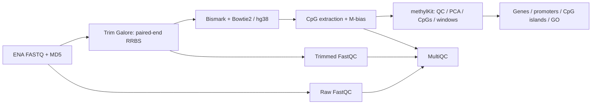

# RRBS methylation analysis pipeline

A reproducible Snakemake workflow for reduced representation bisulfite sequencing (RRBS), from automatic FASTQ and reference downloads to differential DNA methylation and functional annotation. The workflow coordinates established bioinformatics tools, manages dependencies and resources, resumes interrupted runs, and records software versions and input checksums.

**Full dataset run completed:** all 33 scheduled analysis tasks finished successfully on October 29, 2026. The comparison identified **8,212 significant CpG positions** and **51 significant fixed windows** across four samples. These are exploratory findings from two biological replicates per group; completion of the workflow does not replace review of the QC reports.



## Completed run

The contrast is **T2D minus Active**. Positive `meth.diff` values indicate higher methylation in T2D, expressed in percentage points.

| Analysis unit | Tested | Significant | Higher in T2D | Lower in T2D |
|---|---:|---:|---:|---:|
| Individual CpG positions | 2,447,379 | 8,212 | 4,266 | 3,946 |
| Fixed 1,000 bp windows | 84,426 | 51 | 26 | 25 |

Significance thresholds were **q < 0.01** and **absolute methylation difference > 25 percentage points**. Neither analysis reported nonfinite q-values.

- Unique mapping efficiency ranged from **63.0% to 66.9%** across the four samples.
- Pairwise Spearman correlations ranged from approximately **0.910 to 0.914**. Within-group correlations were not consistently higher than between-group correlations.
- Significant CpGs were associated with **2,841 genes**; their combined gene set yielded **83 GO terms with BH-adjusted p < 0.05**.
- Significant windows were associated with **32 genes**; their GO analysis yielded **no terms with BH-adjusted p < 0.05**.

PCA showed variation within the groups. These summaries do not establish robust group clustering, pathway activation, or causal effects. FastQC/MultiQC, coverage, conversion-related indicators, and M-bias plots still require review. See the [run report](docs/RESULTS.md), currently in Russian.

## Dataset

Four public paired-end RRBS samples are used, with two samples per group. Group labels follow the source study metadata.

| Sample | ENA run | Group | Treatment | Read pairs | Compressed FASTQ, GB |
|---|---|---|---:|---:|---:|
| T2D_RES20 | SRR17948848 | T2D | 1 | 27,119,031 | 2.444 |
| Active_RES09 | SRR17948852 | Active | 0 | 28,562,038 | 2.576 |
| Active_RES05 | SRR17948854 | Active | 0 | 25,654,594 | 2.297 |
| T2D_RES03 | SRR17948856 | T2D | 1 | 27,226,700 | 2.434 |

Total: **108,562,363 read pairs** and **9,751,429,946 bytes** of compressed FASTQ, approximately 9.75 GB or 9.08 GiB. GB values use decimal units.

Run metadata, download URLs, and MD5 checksums are recorded in `config/samples.tsv`, based on ENA metadata retrieved on October 29, 2026.

Sources: [GEO GSE196387](https://www.ncbi.nlm.nih.gov/geo/query/acc.cgi?acc=GSE196387), [SRR17948848](https://www.ebi.ac.uk/ena/browser/view/SRR17948848), [SRR17948852](https://www.ebi.ac.uk/ena/browser/view/SRR17948852), [SRR17948854](https://www.ebi.ac.uk/ena/browser/view/SRR17948854), and [SRR17948856](https://www.ebi.ac.uk/ena/browser/view/SRR17948856).

## System requirements

Suggested starting allocation for this dataset: **32 vCPUs, at least 128 GB RAM, approximately 300 GB of free SSD/NVMe storage, and Ubuntu 22.04 or 24.04 on x86_64**. This is a planning estimate, not a measured minimum. The completed server run used 32 vCPUs and approximately 204 GiB RAM; its root volume had approximately 509 GB available before preparation.

The workflow runs on CPUs and does not require GPU acceleration. Cloud vCPUs are not necessarily physical CPU cores. Storage is needed for FASTQ, the reference and bisulfite indices, BAM files, intermediate outputs, and reports. Peak resource usage and storage requirements have not been independently summarized for the completed run.

| Profile | vCPUs | Suggested machine RAM | Suggested free disk | Use |
|---|---:|---:|---:|---|
| `profiles/cpu32` | 32 | 128 GB or more | 300 GB | Default profile |
| `profiles/cpu16` | 16 | 64 GB or more | 200-300 GB | Lower concurrency |
| `profiles/cpu8` | 8 | 128 GB or more | 300 GB | CPU-limited machines with ample RAM |

Profiles reserve memory for the operating system. More resources can improve throughput; protocol choices, QC, statistical modeling, and biological replication determine the reliability of the results.

## Installation

Clone the repository and create the Linux x86_64 environment from the explicit package lock:

```bash
git clone https://github.com/MarFedorovna/rrbs-pipeline.git
cd rrbs-pipeline
conda create -y -n rrbs-pipeline --file environment.linux-64.lock.txt
conda activate rrbs-pipeline
bash scripts/check_server.sh
```

With an installed and initialized micromamba, use these environment commands instead:

```bash
micromamba create -y -n rrbs-pipeline -f environment.linux-64.lock.txt
micromamba activate rrbs-pipeline
bash scripts/check_server.sh
```

The lock records package builds and transitive dependencies, including Bismark 0.25.1 and methylKit 1.32.0. Environment installation also installs the `org.Hs.eg.db` and `GO.db` annotation databases.

For dependency resolution from the main version specifications, use `conda env create -f environment.yml` and export a new explicit lock with `conda list --explicit`. Keep the lock with the run records. Run the workflow on Linux or WSL2; native Windows PowerShell is not a supported execution environment.

## Automatic data preparation

With the environment activated, run:

```bash
bash scripts/prepare_data.sh
```

This downloads eight FASTQ files from ENA and verifies their MD5 checksums, downloads hg38 and UCSC gene/CpG island annotations, creates BED annotations, and builds the Bismark bisulfite indices. Sources and parameters are configured in `config/`. Existing completed inputs and indices are reused.

To inspect the preparation plan without downloading data:

```bash
bash scripts/prepare_data.sh --dry-run
```

Preparation alone does not perform alignment or differential analysis. The full workflow also prepares any missing inputs automatically.

## Run the analysis

Inspect the job plan, then execute the workflow:

```bash
bash scripts/run.sh --dry-run
bash scripts/run.sh
```

The default profile is `profiles/cpu32`. To choose a different profile:

```bash
RRBS_PROFILE=profiles/cpu16 bash scripts/run.sh
# For 8 vCPUs with sufficient RAM:
RRBS_PROFILE=profiles/cpu8 bash scripts/run.sh
```

Run long jobs inside `tmux` to keep them running after an SSH disconnection. After an interruption, repeat the same command: completed tasks are retained, and incomplete downloads restart from the beginning. FASTQ checksums are verified by the download step.

To inspect one sample before running all downstream analyses:

```bash
bash scripts/run.sh results/rrbs/bismark/T2D_RES20/report.html
```

Review FastQC, Bismark, and M-bias reports before interpreting the final results. If the M-bias profiles justify excluding read ends, adjust the relevant `ignore_*` settings and rerun. Clipping parameters should be based on the dataset's reports. Timing and memory benchmarks for selected stages are written to `results/rrbs/benchmarks/`.

## Outputs

All full-dataset outputs are written under `results/rrbs/`.

| Path relative to `results/rrbs/` | Contents |
|---|---|
| `multiqc/multiqc_report.html` | Combined technical QC report |
| `bismark/<sample>/report.html` | Per-sample alignment and methylation extraction report, including M-bias |
| `analysis/qc.pdf` | Methylation and coverage distributions, correlation, clustering, and PCA |
| `analysis/site_counts.tsv` | Loaded and filtered CpG counts per sample |
| `analysis/sample_order.tsv` | Sample order and group assignments |
| `analysis/correlation.tsv`, `analysis/pca_scores.tsv` | Numerical sample QC summaries |
| `analysis/dmp_all.tsv.gz` | All tested CpG positions |
| `analysis/dmp_significant.tsv.gz` | Significant CpG positions |
| `analysis/dmp_hyper.tsv.gz`, `analysis/dmp_hypo.tsv.gz` | Significant positions split by effect direction |
| `analysis/tiles_*.tsv.gz` | Differential analysis of fixed windows |
| `analysis/*_significant.bed` | Significant CpGs and windows in BED format |
| `annotation/*_annotated.tsv.gz` | Tested positions/windows with gene, promoter, and CpG-context annotations |
| `annotation/*_genes.txt`, `annotation/*_background_genes.txt` | Selected and measured background gene sets |
| `annotation/*_go.tsv` | GO overrepresentation results |
| `analysis/summary.json`, `annotation/summary.json` | Statistical settings and result counts |
| `provenance/run.json` | Configuration, software versions, and source/input checksums |

TSV coordinates are **one-based inclusive**. BED coordinates are **zero-based half-open**. The `loaded` counts in `site_counts.tsv` already reflect the minimum coverage applied during methylKit import.

## Analysis settings and limitations

The default configuration uses:

- Paired-end RRBS, directional libraries, and hg38 canonical chromosomes.
- Minimum coverage of 10 reads; exclusion of the top 0.1% of coverage values; coverage normalization; positions required in both samples of each group.
- methylKit with `adjust=qvalue`, `overdispersion=none`, and `test=Chisq`; significance defined by q < 0.01 and absolute methylation difference > 25 percentage points.
- Fixed windows of 1,000 bp with a 1,000 bp step and at least 10 covered CpG-context positions per window before merging samples. Significant windows are not de novo DMRs.
- No coordinate-based deduplication for RRBS; overlapping mates are excluded from double counting during methylation extraction.
- `destrand=FALSE` because Bismark coverage input does not retain the original strand information.
- Promoters extending 2,000 bp upstream and 500 bp downstream of the transcription start site. Promoter overlaps take priority for gene assignment; gene-body overlaps remain available separately.

With two biological replicates per group, statistical power and adjustment for confounders are limited. PCA components are not removed automatically, and missing age or sex covariates are not inferred. A separate sensitivity analysis can use `overdispersion: MN` and `test: F`, with a different `outdir` to preserve the original run.

GO analysis combines genes associated with hyper- and hypomethylated findings, uses measured GO-annotated genes as the background, and applies BH correction across eligible terms. It does not correct RRBS biases related to CpG density or gene length. Gene overlap does not establish regulation, and GO enrichment does not determine the direction of pathway activity.

## Optional RNA-seq integration

To join the methylation annotations to an existing RNA-seq differential expression table:

```bash
python scripts/integrate_rna.py \
  results/rrbs/annotation/dmp_annotated.tsv.gz rna_differential.tsv omics.tsv
```

The RNA table must contain unique gene symbols and the columns `gene`, `log2FoldChange`, and `padj`, with the same T2D-minus-Active contrast. The script joins the tables and averages methylation differences over measured promoter CpGs. It does not process RNA FASTQ files or estimate the absolute methylation level of an entire promoter.

## Technical validation

The repository includes helper tests and a synthetic end-to-end smoke test using the actual analysis tools. To run them after installing the environment:

```bash
python -m unittest discover -s tests -p 'test_*.py' -v
python tests/make_smoke_data.py
snakemake -s workflow/Snakefile --configfile tests/generated/config.yaml \
  --cores 4 --resources mem_mb=6000 downloads=2 --rerun-incomplete
python tests/check_smoke.py
```

The smoke test uses a separate synthetic reference and output directory. It checks execution, formats, and the expected effect direction; it does not validate biological conclusions from the public dataset. GitHub Actions defines helper and synthetic smoke-test jobs. A successful server run does not imply that remote CI has passed.

## Repository contents and documentation

The repository tracks source code, configuration, public accessions and checksums, dependency specifications, tests, and documentation. FASTQ, BAM, downloaded references, installed environments, and generated results are excluded through `.gitignore`; they must be regenerated or archived separately.

Additional documentation is currently in Russian:

- [Completed dataset run](docs/RESULTS.md)
- [Methods and sources](docs/METHODS.md)
- [Synthetic validation record](docs/VALIDATION.md) - records the earlier local test; its pending-run notes predate the completed server run summarized above.
- [Server planning](docs/SERVER.md)

The workflow builds on FastQC, Trim Galore/Cutadapt, Bismark/Bowtie2, samtools, methylKit, UCSC annotations, Bioconductor annotation databases, MultiQC, and Snakemake. The public dataset belongs to its original study; this repository provides the analysis workflow and its configuration.

